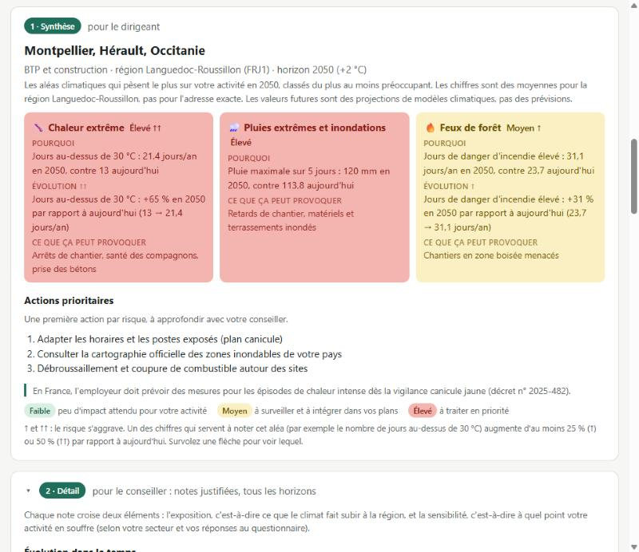
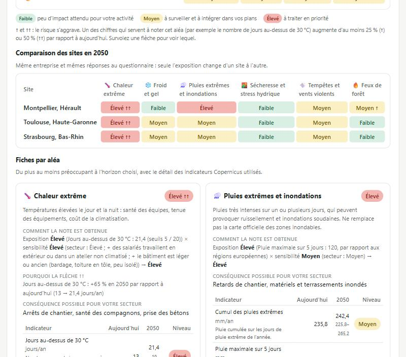

# Risques climatiques physiques pour PME

Un premier repérage, gratuit et sans inscription, des risques climatiques physiques auxquels les sites
d'une PME européenne sont ou seront exposés : chaleur, froid, pluies extrêmes, sécheresse, vent et feux,
aujourd'hui et à +1,5 °C, +2 °C et +3 °C de réchauffement mondial (vers 2030, 2050 et 2100).

**👉 Essayer l'outil : https://niz95.github.io/radar-climat-pme/**



## Comment ça marche

1. Saisissez l'adresse de vos sites, ou cliquez sur la carte.
2. Choisissez votre secteur et répondez à 8 questions sur votre activité.
3. Lisez le rapport en 3 niveaux :
   - **Synthèse**, pour le dirigeant : les 3 risques principaux, le chiffre qui explique chaque note, 3 actions ;
   - **Détail**, pour le conseiller : notes justifiées, tous les horizons, comparaison des sites ;
   - **Annexe**, pour une banque, un assureur ou un auditeur : valeurs, fourchettes entre modèles, sources
     des seuils, export CSV.



## Méthode

- **Données** : Copernicus Climate Change Service, jeu « Aggregated climate indicators for Europe »
  (`sis-ecde-aggregated-climate-indicators` v2.0, CC-BY 4.0) : moyenne multi-modèles et fourchette
  17–83 % entre modèles, par région NUTS 2 (environ 340 régions, découpage 2024). Le climat actuel
  (1991–2020) est recalculé comme la valeur à un niveau de réchauffement moins l'écart à ce niveau.
- **Cadre** : phase de « screening » du guide de la Commission européenne sur le climate proofing des
  infrastructures (C(2021) 5430) : l'exposition et la sensibilité, notées sur 3 niveaux (Faible, Moyen,
  Élevé), sont croisées dans une matrice 3 × 3. Ni ce guide ni la méthode OCARA (Carbone 4 / ADEME) ne
  fixent de seuils chiffrés d'exposition : ceux de l'outil sont indiqués avec leur source.
- **Exposition** : l'indicateur le plus défavorable de l'aléa, selon une règle propre à chaque indicateur
  (`INDICATORS` dans [web/risk-model.js](web/risk-model.js)) :
  - des seuils absolus, conventions du prototype (par exemple, jours au-dessus de 30 °C : 5 et 20 par an) ;
  - pour les pluies, la position par rapport aux régions européennes (75ᵉ et 90ᵉ percentiles) ;
  - pour les indices définis localement (vagues de chaleur, durée des sécheresses, vents extrêmes),
    l'évolution par rapport au climat actuel.
- **Tendance** : ↑ ou ↑↑ quand un indicateur au moins Moyen augmente de 25 % ou 50 % par rapport à
  aujourd'hui, affichée seulement sur un risque Moyen ou Élevé.
- **Sensibilité** : une note par secteur, relevée d'un niveau par réponse « oui » au questionnaire, dont les
  questions suivent les 4 thèmes du guide européen. Ces notes sont des hypothèses, à valider avec des PME.

## Limites

- Les valeurs sont des moyennes sur de grandes régions (NUTS 2) : elles ne décrivent pas un bâtiment, en
  particulier pour les inondations. Consultez les cartes officielles des zones inondables de votre pays.
- Ce sont des projections de modèles climatiques, pas des prévisions.
- Pas encore de crues de rivières, de submersion marine, de grêle ni de mouvements de terrain.
- L'outil est informatif : ni conseil professionnel, ni notation, ni attestation de conformité. Voir
  [les mentions et limites complètes](web/mentions.html).

## Sources et licences

- Code : licence MIT, voir [LICENSE](LICENSE).
- Contient des informations modifiées du Copernicus Climate Change Service (2026). Ni la Commission
  européenne ni l'ECMWF ne sont responsables de l'usage qui peut être fait des informations Copernicus ou
  des données qu'elles contiennent.
- © EuroGeographics pour les limites administratives (GISCO, Eurostat), usage non commercial.
- Fond de carte et recherche d'adresse : © contributeurs OpenStreetMap (ODbL), service Nominatim.
- Outil indépendant, non affilié à Copernicus, à l'ECMWF ni à la Commission européenne.

Auteur : Deniz Caliskan.

## Pour les développeurs

L'application est un site statique (HTML, JavaScript, données JSON) dans [web/](web/), sans serveur ni
compilation. GitHub Pages la publie à chaque push sur `main` ([.github/workflows/pages.yml](.github/workflows/pages.yml)).

### Lancer en local

```
python -m http.server 8765 --directory web
```

puis ouvrir http://localhost:8765.

### Regénérer les données Copernicus

1. Créez un compte gratuit sur https://cds.climate.copernicus.eu.
2. Sur la page du jeu de données
   https://cds.climate.copernicus.eu/datasets/sis-ecde-aggregated-climate-indicators, onglet *Download*,
   acceptez la licence CC-BY en bas de page.
3. Copiez votre clé API depuis votre profil CDS dans le fichier `~/.cdsapirc` (jamais dans le repo) :

   ```
   url: https://cds.climate.copernicus.eu/api
   key: <votre-clé>
   ```

4. Installez les dépendances, téléchargez les fichiers puis construisez les données de l'application :

   ```
   python -m venv .venv
   .venv\Scripts\pip install -r requirements.txt
   .venv\Scripts\python scripts\fetch_cds.py
   .venv\Scripts\python scripts\build_data.py
   ```

   `build_data.py --inspect` décrit les fichiers téléchargés.
